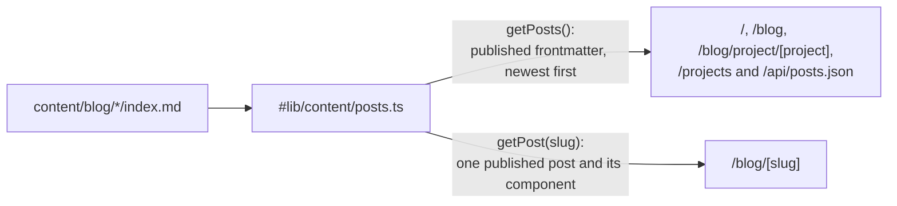

How the site is built and why, for the rules in [`CLAUDE.md`](CLAUDE.md) that follow from it. The directories themselves are listed in the [root README](../README.md#repository-layout).

## A static site

The site is a single SvelteKit app. There is no database, no auth and no CMS: a blog post is a Markdown file in git, and content ships by pushing a commit.

It builds with `adapter-static`, configured in [`vite.config.ts`](../vite.config.ts) with `fallback: '404.html'`. Every page and endpoint is rendered to a file in `build/` during `vite build`, and [`netlify.toml`](../netlify.toml) runs `pnpm run build` and publishes that directory - nothing else is deployed, so Netlify serves files from its CDN and no function runs per view.

Server code still exists - the `+page.server.ts` loads and the `+server.ts` endpoints - but it runs once, in Node, while the site is prerendered. Nothing runs per request, so there are no hooks, form actions, cookies or request headers to read; response headers and redirects go in `netlify.toml` - which is where the year-long cache for the hashed files under `/_app/immutable/` is set, a rule `adapter-netlify` used to write itself - or in Netlify's [`_headers`](https://docs.netlify.com/manage/routing/headers/) and [`_redirects`](https://docs.netlify.com/manage/routing/redirects/overview/) files. For the same reason anything computed while rendering is fixed at build time: the footer's `new Date().getFullYear()` in [`footer.svelte`](../src/lib/components/footer.svelte) is the year of the last build. Per-request rendering would mean going back to `adapter-netlify`.

With no request to take it from, Kit renders every page with `url.origin` set to `paths.origin`, which [`vite.config.ts`](../vite.config.ts) sets to `SITE_URL` from [`src/lib/config.ts`](../src/lib/config.ts). Unset, it would be `http://sveltekit-prerender` ([`prerender.js`](https://github.com/sveltejs/kit/blob/main/packages/kit/src/core/postbuild/prerender.js)), and an absolute URL built from `page.url` would name that instead of the site.

### One site, several domains

Netlify serves the site on `anonymus09.com` and also, as they are rather than redirecting to it, on `matusbarta.sk`, `matusbarta.com` and their `www.` names. Each page names its copy on `anonymus09.com` as the canonical one, through [`page-head.svelte`](../src/lib/components/page-head.svelte), so search engines index one copy rather than four: Google counts `rel="canonical"` a strong signal, a redirect a stronger one ([consolidating duplicate URLs](https://developers.google.com/search/docs/crawling-indexing/consolidate-duplicate-urls)).

`page.url.origin` is `SITE_URL` only while prerendering. In the browser `page.url` is "the URL of the current page" ([`$app/state`](https://svelte.dev/docs/kit/$app-state)), so its origin is the domain the page was opened on, and `<svelte:head>` renders again on a client-side navigation, so a canonical URL built from `page.url.href` would name `matusbarta.sk` there. The component builds it, `og:url` and the preview image's URL from `SITE_URL` and the path instead.

An external uptime check requests `/`, which is `index.html`; there is no healthcheck endpoint, since a static file answering is all one could report.

## Everything is prerendered

`export const prerender = true` in the root [`+layout.ts`](../src/routes/+layout.ts) applies to every page beneath it. Kit starts from its default [`prerender.entries`](https://svelte.dev/docs/kit/configuration#prerender), `['*']` - every route without a required parameter - and crawls the links it finds. `/blog/[slug]` has one, so its [`+page.ts`](../src/routes/blog/[slug]/+page.ts) exports `entries()`, which lists the published slugs rather than relying on whatever the crawler happens to reach.

A layout's options do not reach a `+server.ts`: an endpoint inherits `prerender` only from the pages that fetch it ([page options](https://svelte.dev/docs/kit/page-options#prerender)). No page fetches [`/api/posts.json`](../src/routes/api/posts.json/+server.ts), so it exports its own `prerender = true`, and comes out as `build/api/posts.json`. The extension is in the route's name because the file is served as it is, and the host chooses the `Content-Type` from it - Kit's docs recommend one on every prerendered endpoint. Without it, the file was `build/api/posts`, which `vite preview` served as `text/html`.

[`/sitemap.xml`](../src/routes/sitemap.xml/+server.ts) and [`/robots.txt`](../src/routes/robots.txt/+server.ts) are prerendered endpoints too. The sitemap lists every route folder without a parameter, and the posts and project pages as their `entries()` do, and an end-to-end test compares it with the `.html` files in `build/`. `robots.txt` is an endpoint rather than a file in `static/` so that its `Sitemap:` line comes from `SITE_URL`.

With the default [`trailingSlash`](https://svelte.dev/docs/kit/page-options#trailingSlash), `/about` is written as `about.html`, which Netlify serves at `/about` and redirects `/about/` to ([Netlify support guide](https://answers.netlify.com/t/support-guide-how-can-i-alter-trailing-slash-behaviour-in-my-urls-will-enabling-pretty-urls-help/31191)).

**The build is a link checker.** [`prerender.handleHttpError`](https://svelte.dev/docs/kit/configuration#prerender) defaults to `'fail'`, so an internal link to a page that does not exist stops the build - a post linking to one set to `published: false` included. Its counterpart for `#fragment` links, `handleMissingId`, is `'fail'` too, so a link to a heading must match its `id`. mdsvex adds none of its own; the rehype plugin in [`src/lib/markdown/heading-ids.ts`](../src/lib/markdown/heading-ids.ts), registered in `rehypePlugins` in [`vite.config.ts`](../vite.config.ts), gives every heading one. It takes [`github-slugger`](https://github.com/Flet/github-slugger)'s slug of the text after removing emoji, and trims hyphens left at either end: `## 2024` becomes `id="2024"`, `#### Firebase 🔥` `id="firebase"` rather than github-slugger's `firebase-`, and a repeated id gets `-1`, `-2`. Headings keep their emoji, and a post links to them as `[2024](#2024)`. The ids differ from github-slugger's where a heading has emoji, starts or ends in punctuation, or repeats an earlier one once those are gone. github-slugger aims to match GitHub's ids, so such a link most likely does not work in GitHub's own view of the file (not checked on GitHub).

**The fallback switches off adapter-static's own safety check.** Without a `fallback`, the adapter refuses to build if any route was not prerendered; with one, it skips the check entirely ([`index.js`](https://github.com/sveltejs/kit/blob/main/packages/adapter-static/index.js)), and a route that failed to prerender is simply served the fallback. Kit's [`prerender.handleUnseenRoutes`](https://svelte.dev/docs/kit/configuration#prerender), `'fail'` by default, still catches a route marked prerenderable that was never reached. After a build, the `.html` files in `build/` show what was actually built.

## The 404 page

`404.html` is the fallback: an empty shell, with no title and no content, whose client-side router renders the error page once its JavaScript runs - SvelteKit's default one, as the app has no `+error.svelte`. Netlify serves a `404.html` from the publish directory "automatically for any failed paths" ([redirect options](https://docs.netlify.com/manage/routing/redirects/redirect-options/#custom-404-page-handling)). A crawler or a browser without JavaScript sees the empty shell.

## Configuration lives in `vite.config.ts`

There is no `svelte.config.js`. What it used to hold - the adapter, the runes `compilerOptions`, `paths.origin`, the mdsvex `preprocess` and `extensions` - is passed to the `sveltekit()` plugin in `vite.config.ts`. Since SvelteKit 3 that is the only place it can go - Kit stops with a `config_file_unsupported` error if a `svelte.config.js` exists ([migration guide](https://svelte.dev/docs/kit/migrating-to-sveltekit-3#Configuration-svelte.config.js-is-no-longer-supported)). `sveltekit()` takes Kit's configuration and the plugin's options as one object, so Kit-level keys sit flat beside the plugin's rather than nested under `kit`. `svelte-check` and `eslint-plugin-svelte` read it from there, and [`eslint.config.js`](../eslint.config.js) imports no Svelte config.

## Blog posts

`content/blog/` is the content store, deliberately outside `src/`: one folder per post, holding its Markdown as `index.md` and the images it uses. mdsvex preprocesses it, and `extensions: ['.svelte', '.svx', '.md']` makes every `.md` file a Svelte component, so a post may contain markup.

Every route that reads that directory goes through [`#lib/content/posts.ts`](../src/lib/content/posts.ts), and it reads it with one lazy `import.meta.glob`, so each post compiles to a chunk of its own:

- `getPosts()` loads every module to read its `metadata` - the frontmatter - keeps the posts marked `published`, and sorts them newest first. Because it loads every post, **only code that runs at build time calls it**: the loads of [`/`](../src/routes/+page.server.ts), [`/blog`](../src/routes/blog/+page.server.ts), [`/blog/project/[project]`](../src/routes/blog/project/[project]/+page.server.ts) and [`/projects`](../src/routes/projects/+page.server.ts) are `+page.server.ts` files, whose data reaches the browser as the prerendered `__data.json` beside each page, plus `/api/posts.json` and the `entries()` of `/blog/[slug]` and `/blog/project/[project]`. Called from a universal `+page.ts`, it would put every post into that page's client bundle.
- `getPost(slug)` loads one module and returns its default export - the compiled component - with its frontmatter. `/blog/[slug]` calls it from a universal `+page.ts`, because a component cannot pass through a server load: what one returns must be serializable ([loading data](https://svelte.dev/docs/kit/load#Universal-vs-server-Output)).

The glob is lazy on purpose. An eager glob of the same files beside it would turn every post into a static import, which Vite reports as `INEFFECTIVE_DYNAMIC_IMPORT`, and the bodies would no longer load separately.

**The slug is the folder name**, never a frontmatter field: `toSlug()` derives it from the path and merges it into the metadata, so renaming a post's folder changes its URL.

**A post's `project` names a project by its folder's name** - `project: open-rmm` for `content/projects/open-rmm/index.md` - the same name `/projects` gives that project's card as its `id`. A name, not the title, so rewording a title breaks no link. `toPost()` checks it against a lazy glob of `content/projects/*/index.md` whose keys alone it reads, so an unknown name fails the build, and the check loads no project: Vite reduces such a glob to the file names. An eager glob there, as `#lib/content/projects.ts` uses, would bundle every project into every post. Each project a post names gets `/blog/project/<name>`, listing its posts, and its cards on `/projects` and the home page link there, as does the project's badge on the post's card on `/blog`.

**`published: false` keeps a post off the site, not out of the deploy.** The post is not in the list or in `entries()`, so no page is built for it, and `getPost()` returns nothing for it, so a direct link gets the 404. Its compiled body is still a chunk under `build/_app/`, though, because the glob takes every file. Anything that must actually stay private belongs on an unmerged branch.

Frontmatter must satisfy the `PostFrontmatter` type in [`src/lib/types/post.ts`](../src/lib/types/post.ts): `title`, `date`, `description`, `img` and `published`, and optionally `img_transparent` and `img_crop`. `img` is the cover, a file in the post's folder written as `./cover.png`. A cover is cropped to the frame it is shown in - 16:9 on `/blog` (2:1 on a phone), a 176px strip on the post itself - and `img_crop` names the part that stays: the top unless it says otherwise, or `center`, another side such as `left`, or a corner such as `top-left`. [`#lib/cover.ts`](../src/lib/cover.ts) turns it into the classes; without one, a cover wider than its frame is fitted whole rather than losing its sides, and one marked `img_transparent: true` is always fitted, on a light backdrop. A value it doesn't know fails the build. `toPost()` swaps it for the built image, so a `Post` - and each entry of `/api/posts.json` - carries an enhanced-img `Picture`, or a URL for an SVG, and a cover with no file behind it fails the build.

## Images

Every image a page shows is imported through Vite and gets a hashed filename; `static/` holds only what needs a fixed URL, such as the easter-egg image under `static/media/`.

**Raster images go through [`@sveltejs/enhanced-img`](https://svelte.dev/docs/kit/images)**, registered before `sveltekit()` in [`vite.config.ts`](../vite.config.ts) as its docs require. It builds AVIF, WebP and the original format in several widths, and gives the `` its intrinsic `width` and `height`. It takes SVG only as a static import ([images docs](https://svelte.dev/docs/kit/images)), so the globs import SVGs with `?url` instead, and `<enhanced:img>` renders a plain `` for a string `src`.

**Which widths get built is decided where the image is imported**, not by the `sizes` on the element. For a static `src`, enhanced-img reads the element's `sizes`; for one passed in as a value, the import's query decides, and the `sizes` attribute only tells the browser which to pick. So the two must agree:

- [`src/lib/content/post-images.ts`](../src/lib/content/post-images.ts) imports every image beside a post with the post column's `sizes` (`(min-width: 1024px) 832px, 100vw`) as `imgSizes`, which makes enhanced-img ask for a fixed list of widths from 540px up, plus the original's - the same list whatever `sizes` says, as long as there is one ([`index.js`](https://github.com/sveltejs/kit/blob/main/packages/enhanced-img/src/index.js)). Only the ones up to the original's width are built: in a build on 2026-10-21, a 960px image stopped at 960w. The covers reuse those files, and `coverSize()` in [`#lib/cover.ts`](../src/lib/cover.ts) writes their `sizes`: the frame's width, or - for a cover wider than its frame and cropped to its height - the width it then renders at, such as `max(384px, 879px)` for the 4:1 Open RMM screenshot in a 384px card. Given only the frame's width, the browser chose a file that width and stretched it. On a phone the `/blog` frame is the card's full width at 2:1, so its height follows its width; given no height, `coverSize()` multiplies the frame's width by how many times wider than the frame the cover is - `calc(calc(100vw - 32px) * 2.04)` for the same screenshot.
- The avatar on `/` and the project logos, which always show at a fixed size, ask for two widths with `w` instead.

**A `width` and `height` on an `<enhanced:img>` whose `src` is a value must be literal numbers.** For a raster image the plugin writes the image's own dimensions onto the ``, unless the element has its own - and it reads the element's only from literals ([`vite-plugin.js`](https://github.com/sveltejs/kit/blob/main/packages/enhanced-img/src/vite-plugin.js)). Given an expression, it adds its own as well, and Svelte stops the build with "Attributes need to be unique" ([`attribute_duplicate`](https://svelte.dev/e/attribute_duplicate); checked with a build on 2026-10-21). The covers and the project logos carry their frame's size, `width="384" height="216"` on `/blog`, which a raster cover's own dimensions then give way to; the CSS sizes the frame either way.

**A post's own images are swapped in through an mdsvex layout.** mdsvex wraps every Markdown file under a `blog/` folder in [`blog-layout.svelte`](../src/lib/markdown/blog-layout.svelte), and the `img` that layout exports from its `<script module>` replaces every `` in the post ([custom components](https://mdsvex.pngwn.at/docs)). That component, [`image.svelte`](../src/lib/markdown/image.svelte), resolves `./name.png` against the post's folder, so it needs the slug: `/blog/[slug]` provides it through a context, as a getter, since moving from one post to another reuses the page component. A path that isn't relative - an external URL - renders as a plain ``. The project blurbs are under no `blog/` folder, so they get no layout.

**`layoutPropForwarding: 'runes'` is what lets that layout run under the forced runes mode.** By default mdsvex 0.12 hands a layout its props as `{...$$props}`, which runes mode rejects; with the option, which [its type definitions](https://unpkg.com/mdsvex@0.12.8/dist/main.d.ts) list, the generated code declares them with `$props()` instead. That is from its bundled source, and a build on 2026-10-21 confirmed it. So `.md` files compile in runes mode like everything else.

**`<enhanced:img>` wraps the `` in a `<picture>`**, which would become the flex or grid item in its place. `layout.css` gives `picture` `display: contents`, so the `` lays out exactly as a bare one would. That makes the `<source>` elements beside it layout items too - empty, but each still taking a `gap` in a flex or grid parent, which pushed a post's cover down its card - so `layout.css` hides them; the browser chooses a source from its attributes, not its box. Both rules are unlayered, so they also beat the typography plugin's `picture { display: block }`. A `Card`'s own rule for an image as its first child looks for a direct `` and misses the `<picture>`, so the post page drops the card's top padding itself. `svelte-check` does not run the enhanced-img preprocessor and sees no `` there either, so a component styles one through a class rather than an `img` selector, as the cover on `/blog/[slug]` does.

## One Markdown renderer

mdsvex compiles all Markdown **at build time**: the posts, and the project blurbs. A project is laid out as a post is, a folder `content/projects/<slug>/` with its blurb in `index.md` and its logo beside it, the folder's name being the slug. [`src/lib/content/projects.ts`](../src/lib/content/projects.ts) reads the blurbs with an eager glob - `/projects` shows all of them, so they ship together anyway - and sorts them by their `order`. Their frontmatter, the `ProjectFrontmatter` type in [`src/lib/types/project.ts`](../src/lib/types/project.ts), names the logo relative to the folder, `img: ./openrmm.png`, as a post names its cover, and a second glob over the folders turns the path into the built image; a path with no file there fails the build. A blurb can't yet show an image in its text, ``: the layout that swaps those in finds them through the post page's slug and `post-images.ts`, which only cover posts. What `getProjects()` returns is that type's `Project` - the frontmatter with the slug, the built logo and the compiled blurb - as `Post` is a post's frontmatter made ready for the pages.

**Code blocks are highlighted by [Shiki](https://shiki.style/guide/install) at build time**, through mdsvex's `highlight.highlighter` option in [`vite.config.ts`](../vite.config.ts). One highlighter is created for the whole build, as Shiki's docs recommend, and it loads only the languages the posts use, so a block in another language fails the build until that language is added. The output carries the `monokai` theme's colours as inline styles, so no stylesheet or script ships. mdsvex injects the HTML as `{@html …}` in a template literal, so `escapeSvelte()` from mdsvex escapes the braces and backticks Svelte would otherwise read, and every backslash is escaped too, since the template literal would drop it.

mdsvex 0.12.8 bundles an old unified pipeline, so a remark or rehype plugin from npm has to be tested before it goes in. The heading-id plugin is the repository's own and only walks the tree, so it doesn't depend on unified's version.

## Styling

Tailwind v4 runs through `@tailwindcss/vite`, with **no `tailwind.config` file**. The theme is [shadcn-svelte's](https://shadcn-svelte.com/docs/theming): CSS variables in [`src/routes/layout.css`](../src/routes/layout.css), which an `@theme inline` block maps to Tailwind colours, so `bg-card` is `var(--card)`. `inline` makes a utility use the variable itself rather than a theme variable that points at it ([Tailwind's docs](https://tailwindcss.com/docs/theme#referencing-other-variables)), which is what lets the light and dark values swap.

`:root` holds the light values and `.dark` the dark ones, and the site has only the dark: [`app.html`](../src/app.html) puts `class="dark"` on `<html>`, so `:root`'s values, the Mist base colour as `init` wrote it, wait for a light mode. The dark values are shadcn-svelte's Mist, with the site's greens on `--primary` and `--ring`, and three tokens shadcn has no role for: `--mark` and `--mark-foreground`, the skewed highlight behind `@anonymus09` on the home page, and `--link-hover`, which reuses the mark's lime. The text colours the pages use - `foreground`, `muted-foreground`, `primary` and `link-hover` on the background and on cards, `mark-foreground` on `mark`, `primary-foreground` on `primary` - clear [WCAG's 4.5:1](https://www.w3.org/TR/WCAG22/#contrast-minimum), and the focus outline, `--ring` at half opacity, clears the 3:1 of [non-text contrast](https://www.w3.org/TR/WCAG22/#non-text-contrast). The lowest are `mark-foreground` on `mark`, 5.8:1, and the focus outline on a card, 3.9:1 (computed when the colours were chosen, 2026-10-21).

[`components.json`](../components.json) records what the shadcn-svelte CLI was set up with - the Nova style, the Mist base colour, Lucide icons and the `#lib` aliases. `init` edits `layout.css` in place rather than replacing it - the first run kept the element rules below, but put its colour mappings into the `@theme` block that was there - and [`apply`](https://shadcn-svelte.com/docs/cli#apply), which re-applies a preset's theme or fonts, writes to the same file (not tried yet). Either needs its diff to `layout.css` reviewed.

**Markdown is styled by a class, not by element rules.** mdsvex output is plain HTML with no classes, so it used to look right only because `layout.css` styled the bare `h1`–`h4`, `a`, `p`, `ul`, `pre`, `code`, `img` and `button` - rules that reached every component as well, and, being unlayered, beat any Tailwind utility a component set. Now the [typography plugin](https://github.com/tailwindlabs/tailwindcss-typography)'s `prose` class styles it, in the theme's colours: `@utility prose-site` in `layout.css` maps the plugin's `--tw-prose-*` variables to the tokens, makes inline code a chip rather than backticks, and gives code blocks the green left border. [`blog-layout.svelte`](../src/lib/markdown/blog-layout.svelte) wraps every post in `prose max-w-none prose-site`, and [`project-card.svelte`](../src/lib/components/project-card.svelte) each project blurb. `max-w-none` keeps today's column until the layout sets the reading width. The page and site chrome is styled where it is written, with utilities and shadcn-svelte's components.

**shadcn-svelte's components live in `src/lib/components/ui/`, as its CLI generated them.** `pnpm dlx shadcn-svelte@latest add <name>` writes them and `update` replaces them, so an edit there would be lost or would block the next update. [`.prettierignore`](../.prettierignore) skips the folder, since reformatting is an edit too, and [`eslint.config.js`](../eslint.config.js) turns off `svelte/no-navigation-without-resolve` for it, because `Button` renders whatever `href` its caller passes. A component is styled through the theme's tokens, its documented variants and props, and `class` on the usage; where that is not enough, one of the site's own components wraps it. The site's own components sit beside the folder, in `src/lib/components/` - `page-header.svelte`, for a page's title, which no shadcn component covers.

Not every shadcn component fits. `Avatar` is not used for the avatar on `/`: its image is `display: none` until JavaScript has loaded it in an `Image()` ([bits-ui's `avatar.svelte.js`](https://github.com/huntabyte/bits-ui/blob/main/packages/bits-ui/src/lib/bits/avatar/avatar.svelte.ts)), and it takes a single `src`, so the prerendered page would show no avatar until hydration and would lose enhanced-img's formats and widths.

Nor is every one used whole. The phone menu, [`nav-menu.svelte`](../src/lib/components/nav/nav-menu.svelte), is a `Sheet` that leaves the page behind it sharp, so that only the menu's own glass blurs it. `Sheet.Content` always renders the Sheet's overlay, which dims and blurs the page, and passes it no props, so the menu is put together from the Sheet's exported parts instead: its `Overlay`, made transparent but kept, so that a tap outside lands on it rather than on a link behind it, and bits-ui's `Dialog.Content`, which `Sheet.Content` renders itself, with the menu's own classes.

**A layout that differs between phones and desktops differs through CSS breakpoints, not by swapping components in JavaScript.** Every page is rendered at build time, when there is no screen to measure, so a component chosen by a media query in JavaScript - Svelte's `MediaQuery`, say - would be the desktop one in the HTML, and a phone would show it until hydration swapped it, or for good without JavaScript. A breakpoint is applied by the browser before the first paint. So [`latest-posts.svelte`](../src/lib/components/latest-posts.svelte) is one list - plain links from `sm:`, full-width rows to tap below it - and the home card, the `/blog` cards and the project cards rearrange the same way. The breakpoint is the width, as everywhere else in the layout, rather than `pointer-coarse:`, which would also give a touch tablet in landscape the phone's rows.

**Overriding a generated component's layout through `class` meets three things Tailwind does by default.** `cn()`, the `cn` package's stand-in for clsx and tailwind-merge, replaces a component's class with a conflicting one of ours only under the same variant - in the rendered classes, our `row-span-3` replaced `Card.Action`'s `row-span-2`, while `Card.Header`'s `has-data-[slot=card-description]:grid-rows-[auto_auto]` stayed beside a plain `grid-rows-*` and beat it, as `:has()` adds to its specificity; so the home card's override repeats the variant, `max-sm:has-data-[slot=card-description]:grid-rows-[…]`. `row-span-*` sets the `grid-row` shorthand ([grid-row](https://tailwindcss.com/docs/grid-row)), so under a variant, which comes later in the stylesheet, it resets the `row-start-*` a component set, and the start has to be repeated under the same variant. And preflight caps every `img` at `max-width: 100%` ([preflight](https://tailwindcss.com/docs/preflight#images-are-constrained-to-the-parent-width)), so an image widened past its container - the `/blog` cover, edge to edge on a phone - needs `max-w-none` as well.

A component `<style>` block that uses Tailwind needs `@reference "#app.css"`. `#app.css` is a subpath import declared under `"imports"` in [`package.json`](../package.json), resolving to `src/routes/layout.css`, so the reference does not depend on where the component sits; Prettier's `tailwindStylesheet` in [`prettier.config.js`](../prettier.config.js) points at the same file, so class sorting knows the custom colours.

Internal links go through `resolve()` from `$app/paths`, which `eslint-plugin-svelte`'s `svelte/no-navigation-without-resolve` enforces - on `<a>` elements only. A `Button` given an `href` renders an `<a>`, but the rule never sees it (checked with a `<Button href="/blog">`, which passes), so a `Button` that links inside the site needs `resolve()` written by hand. An `<a>` to an external URL held in a variable needs the rule disabled for that line or file, rather than the rule being weakened globally.
