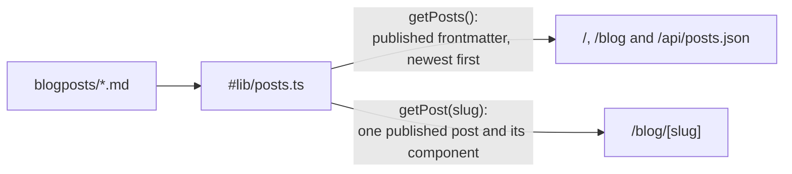

How the site is built and why, for the rules in [`CLAUDE.md`](CLAUDE.md) that follow from it. The directories themselves are listed in the [root README](../README.md#repository-layout).

## A static site

The site is a single SvelteKit app. There is no database, no auth and no CMS: a blog post is a Markdown file in git, and content ships by pushing a commit.

It builds with `adapter-static`, configured in [`vite.config.ts`](../vite.config.ts) with `fallback: '404.html'`. Every page, and the one endpoint, is rendered to a file in `build/` during `vite build`, and [`netlify.toml`](../netlify.toml) runs `pnpm run build` and publishes that directory - nothing else is deployed, so Netlify serves files from its CDN and no function runs per view.

Server code still exists - the `+page.server.ts` loads and the `+server.ts` endpoint - but it runs once, in Node, while the site is prerendered. Nothing runs per request, so there are no hooks, form actions, cookies or request headers to read; response headers and redirects go in `netlify.toml` - which is where the year-long cache for the hashed files under `/_app/immutable/` is set, a rule `adapter-netlify` used to write itself - or in Netlify's [`_headers`](https://docs.netlify.com/manage/routing/headers/) and [`_redirects`](https://docs.netlify.com/manage/routing/redirects/overview/) files. For the same reason anything computed while rendering is fixed at build time: the footer's `new Date().getFullYear()` in [`footer.svelte`](../src/lib/components/footer.svelte) is the year of the last build. Per-request rendering would mean going back to `adapter-netlify`.

With no request to take it from, Kit renders every page with `url.origin` set to `paths.origin`, which [`vite.config.ts`](../vite.config.ts) sets to `SITE_URL` from [`src/lib/config.ts`](../src/lib/config.ts). Unset, it would be `http://sveltekit-prerender` ([`prerender.js`](https://github.com/sveltejs/kit/blob/main/packages/kit/src/core/postbuild/prerender.js)), and an absolute URL built from `page.url` would name that instead of the site.

An external uptime check requests `/`, which is `index.html`; there is no healthcheck endpoint, since a static file answering is all one could report.

## Everything is prerendered

`export const prerender = true` in the root [`+layout.ts`](../src/routes/+layout.ts) applies to every page beneath it. Kit starts from its default [`prerender.entries`](https://svelte.dev/docs/kit/configuration#prerender), `['*']` - every route without a required parameter - and crawls the links it finds. `/blog/[slug]` has one, so its [`+page.ts`](../src/routes/blog/[slug]/+page.ts) exports `entries()`, which lists the published slugs rather than relying on whatever the crawler happens to reach.

A layout's options do not reach a `+server.ts`: an endpoint inherits `prerender` only from the pages that fetch it ([page options](https://svelte.dev/docs/kit/page-options#prerender)). No page fetches [`/api/posts.json`](../src/routes/api/posts.json/+server.ts), so it exports its own `prerender = true`, and comes out as `build/api/posts.json`. The extension is in the route's name because the file is served as it is, and the host chooses the `Content-Type` from it - Kit's docs recommend one on every prerendered endpoint. Without it, the file was `build/api/posts`, which `vite preview` served as `text/html`.

With the default [`trailingSlash`](https://svelte.dev/docs/kit/page-options#trailingSlash), `/about` is written as `about.html`, which Netlify serves at `/about` and redirects `/about/` to ([Netlify support guide](https://answers.netlify.com/t/support-guide-how-can-i-alter-trailing-slash-behaviour-in-my-urls-will-enabling-pretty-urls-help/31191)).

**The build is a link checker.** [`prerender.handleHttpError`](https://svelte.dev/docs/kit/configuration#prerender) defaults to `'fail'`, so an internal link to a page that does not exist stops the build - a post linking to one set to `published: false` included. Its counterpart for `#fragment` links, `handleMissingId`, is `'fail'` too, so a link to a heading must match its `id`. mdsvex adds none of its own; the rehype plugin in [`src/lib/markdown/heading-ids.ts`](../src/lib/markdown/heading-ids.ts), registered in `rehypePlugins` in [`vite.config.ts`](../vite.config.ts), gives every heading one. It takes [`github-slugger`](https://github.com/Flet/github-slugger)'s slug of the text after removing emoji, and trims hyphens left at either end: `## 2024` becomes `id="2024"`, `#### Firebase 🔥` `id="firebase"` rather than github-slugger's `firebase-`, and a repeated id gets `-1`, `-2`. Headings keep their emoji, and a post links to them as `[2024](#2024)`. The ids differ from github-slugger's where a heading has emoji, starts or ends in punctuation, or repeats an earlier one once those are gone. github-slugger aims to match GitHub's ids, so such a link most likely does not work in GitHub's own view of the file (not checked on GitHub).

**The fallback switches off adapter-static's own safety check.** Without a `fallback`, the adapter refuses to build if any route was not prerendered; with one, it skips the check entirely ([`index.js`](https://github.com/sveltejs/kit/blob/main/packages/adapter-static/index.js)), and a route that failed to prerender is simply served the fallback. Kit's [`prerender.handleUnseenRoutes`](https://svelte.dev/docs/kit/configuration#prerender), `'fail'` by default, still catches a route marked prerenderable that was never reached. After a build, the `.html` files in `build/` show what was actually built.

## The 404 page

`404.html` is the fallback: an empty shell, with no title and no content, whose client-side router renders the error page once its JavaScript runs - SvelteKit's default one, as the app has no `+error.svelte`. Netlify serves a `404.html` from the publish directory "automatically for any failed paths" ([redirect options](https://docs.netlify.com/manage/routing/redirects/redirect-options/#custom-404-page-handling)). A crawler or a browser without JavaScript sees the empty shell.

## Configuration lives in `vite.config.ts`

There is no `svelte.config.js`. What it used to hold - the adapter, the runes `compilerOptions`, `paths.origin`, the mdsvex `preprocess` and `extensions` - is passed to the `sveltekit()` plugin in `vite.config.ts`. Since SvelteKit 3 that is the only place it can go - Kit stops with a `config_file_unsupported` error if a `svelte.config.js` exists ([migration guide](https://svelte.dev/docs/kit/migrating-to-sveltekit-3#Configuration-svelte.config.js-is-no-longer-supported)). `sveltekit()` takes Kit's configuration and the plugin's options as one object, so Kit-level keys sit flat beside the plugin's rather than nested under `kit`. `svelte-check` and `eslint-plugin-svelte` read it from there, and [`eslint.config.js`](../eslint.config.js) imports no Svelte config.

## Blog posts

`blogposts/*.md` is the content store, deliberately outside `src/`. mdsvex preprocesses it, and `extensions: ['.svelte', '.svx', '.md']` makes every `.md` file a Svelte component, so a post may contain markup.

Every route that reads that directory goes through [`#lib/posts.ts`](../src/lib/posts.ts), and it reads it with one lazy `import.meta.glob`, so each post compiles to a chunk of its own:

- `getPosts()` loads every module to read its `metadata` - the frontmatter - keeps the posts marked `published`, and sorts them newest first. Because it loads every post, **only code that runs at build time calls it**: the loads of [`/`](../src/routes/+page.server.ts) and [`/blog`](../src/routes/blog/+page.server.ts) are `+page.server.ts` files, whose data reaches the browser as the prerendered `__data.json` beside each page, plus `/api/posts.json` and the `entries()` of `/blog/[slug]`. Called from a universal `+page.ts`, it would put every post into that page's client bundle.
- `getPost(slug)` loads one module and returns its default export - the compiled component - with its frontmatter. `/blog/[slug]` calls it from a universal `+page.ts`, because a component cannot pass through a server load: what one returns must be serializable ([loading data](https://svelte.dev/docs/kit/load#Universal-vs-server-Output)).

The glob is lazy on purpose. An eager glob of the same files beside it would turn every post into a static import, which Vite reports as `INEFFECTIVE_DYNAMIC_IMPORT`, and the bodies would no longer load separately.

**The slug is the filename**, never a frontmatter field: `toSlug()` derives it from the path and merges it into the metadata, so renaming a file changes its URL.

**`published: false` keeps a post off the site, not out of the deploy.** The post is not in the list or in `entries()`, so no page is built for it, and `getPost()` returns nothing for it, so a direct link gets the 404. Its compiled body is still a chunk under `build/_app/`, though, because the glob takes every file. Anything that must actually stay private belongs on an unmerged branch.

Frontmatter must satisfy the `Post` type in [`src/lib/types/post.ts`](../src/lib/types/post.ts): `title`, `date`, `description`, `img`, `img_transparent` and `published`. `img` is a URL into `static/` (`/media/blog/<slug>/…`), not a Vite import, so those images are served verbatim and are neither hashed nor optimised - unlike the images under `src/lib/assets/`, which are imported and get hashed filenames.

## One Markdown renderer

mdsvex compiles all Markdown **at build time**: the posts, and the project blurbs in `content/projects/*.md`. [`src/lib/projects.ts`](../src/lib/projects.ts) reads the blurbs with an eager glob - `/projects` shows all of them, so they ship together anyway - and sorts them by their `order`. Their frontmatter, the `Project` type in [`src/lib/types/project.ts`](../src/lib/types/project.ts), names the logo by file name, which a second glob over `src/lib/assets/projects/` turns into the built URL; a name with no file there fails the build.

**Code blocks are highlighted by [Shiki](https://shiki.style/guide/install) at build time**, through mdsvex's `highlight.highlighter` option in [`vite.config.ts`](../vite.config.ts). One highlighter is created for the whole build, as Shiki's docs recommend, and it loads only the languages the posts use, so a block in another language fails the build until that language is added. The output carries the `monokai` theme's colours as inline styles, so no stylesheet or script ships. mdsvex injects the HTML as `{@html …}` in a template literal, so `escapeSvelte()` from mdsvex escapes the braces and backticks Svelte would otherwise read, and every backslash is escaped too, since the template literal would drop it.

mdsvex 0.12.8 bundles an old unified pipeline, so a remark or rehype plugin from npm has to be tested before it goes in. The heading-id plugin is the repository's own and only walks the tree, so it doesn't depend on unified's version.

## Styling

Tailwind v4 runs through `@tailwindcss/vite`, with **no `tailwind.config` file**. The theme is an `@theme` block in [`src/routes/layout.css`](../src/routes/layout.css): `--color-accent-color`, `--color-accent-color-lighter`, `--color-background` and `--color-window-gray`.

**That same file is the global element stylesheet, and the blog depends on it.** Bare `h1`–`h4`, `a`, `p`, `ul`, `pre`, `code`, `img`, `input`, `textarea` and `button` are styled there, and that is the only reason mdsvex output - plain HTML carrying no classes - looks right. Narrowing those selectors into component scope would unstyle every post.

A component `<style>` block that uses Tailwind needs `@reference "#app.css"`. `#app.css` is a subpath import declared under `"imports"` in [`package.json`](../package.json), resolving to `src/routes/layout.css`, so the reference does not depend on where the component sits; Prettier's `tailwindStylesheet` in [`prettier.config.js`](../prettier.config.js) points at the same file, so class sorting knows the custom colours. The commented-out form in `src/routes/contact/+page.svelte` still carries an old `@reference "../../app.css"`; that path no longer exists, so uncommenting it as-is will not build.

Internal links go through `resolve()` from `$app/paths`, which `eslint-plugin-svelte`'s `svelte/no-navigation-without-resolve` enforces. `post.svelte` disables the rule at the top of the file because its links are external GitHub URLs - a local disable keeps the rule working everywhere else.
