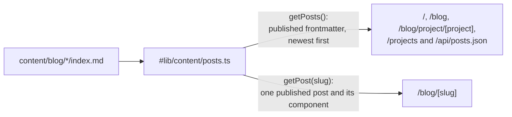

How the site is built and why, for the rules in [`CLAUDE.md`](CLAUDE.md) that follow from it. The directories themselves are listed in the [root README](../README.md#repository-layout).

## A static site

The site is a single SvelteKit app. There is no database, no auth and no CMS: a blog post is a Markdown file in git, and content ships by pushing a commit.

It builds with `adapter-static`, configured in [`vite.config.ts`](../vite.config.ts) with `fallback: '404.html'`. Every page and endpoint is rendered to a file in `build/` during `vite build`, and [`netlify.toml`](../netlify.toml) runs `pnpm run build` and publishes that directory - nothing else is deployed, so Netlify serves files from its CDN and no function runs per view.

Server code still exists - the `+page.server.ts` loads and the `+server.ts` endpoints - but it runs once, in Node, while the site is prerendered. Nothing runs per request, so there are no hooks, form actions, cookies or request headers to read; response headers and redirects go in `netlify.toml` - which is where the year-long cache for the hashed files under `/_app/immutable/` is set, a rule `adapter-netlify` used to write itself - or in Netlify's [`_headers`](https://docs.netlify.com/manage/routing/headers/) and [`_redirects`](https://docs.netlify.com/manage/routing/redirects/overview/) files. For the same reason anything computed while rendering is fixed at build time: the footer's `new Date().getFullYear()` in [`footer.svelte`](../src/lib/components/footer.svelte) is the year of the last build. Per-request rendering would mean going back to `adapter-netlify`.

With no request to take it from, Kit renders every page with `url.origin` set to `paths.origin`, which [`vite.config.ts`](../vite.config.ts) sets to `SITE_URL` from [`src/lib/config.ts`](../src/lib/config.ts). Unset, it would be `http://sveltekit-prerender` ([`prerender.js`](https://github.com/sveltejs/kit/blob/main/packages/kit/src/core/postbuild/prerender.js)), and an absolute URL built from `page.url` would name that instead of the site.

### One site, several domains

Netlify serves the site on `anonymus09.com` and also, as they are rather than redirecting to it, on `matusbarta.sk`, `matusbarta.com` and their `www.` names. Each page names its copy on `anonymus09.com` as the canonical one, through [`page-head.svelte`](../src/lib/components/page-head.svelte), so search engines index one copy rather than four: Google counts `rel="canonical"` a strong signal, a redirect a stronger one ([consolidating duplicate URLs](https://developers.google.com/search/docs/crawling-indexing/consolidate-duplicate-urls)).

`page.url.origin` is `SITE_URL` only while prerendering. In the browser `page.url` is "the URL of the current page" ([`$app/state`](https://svelte.dev/docs/kit/$app-state)), so its origin is the domain the page was opened on, and `<svelte:head>` renders again on a client-side navigation, so a canonical URL built from `page.url.href` would name `matusbarta.sk` there. The component builds it, `og:url` and the preview image's URL from `SITE_URL` and the path instead.

An external uptime check requests `/`, which is `index.html`; there is no healthcheck endpoint, since a static file answering is all one could report.

## Everything is prerendered

`export const prerender = true` in the root [`+layout.ts`](../src/routes/+layout.ts) applies to every page beneath it. Kit starts from its default [`prerender.entries`](https://svelte.dev/docs/kit/configuration#prerender), `['*']` - every route without a required parameter - and crawls the links it finds. `/blog/[slug]` has one, so its [`+page.ts`](../src/routes/blog/[slug]/+page.ts) exports `entries()`, which lists the published slugs rather than relying on whatever the crawler happens to reach.

A layout's options do not reach a `+server.ts`: an endpoint inherits `prerender` only from the pages that fetch it ([page options](https://svelte.dev/docs/kit/page-options#prerender)). No page fetches [`/api/posts.json`](../src/routes/api/posts.json/+server.ts), so it exports its own `prerender = true`, and comes out as `build/api/posts.json`. The extension is in the route's name because the file is served as it is, and the host chooses the `Content-Type` from it - Kit's docs recommend one on every prerendered endpoint. Without it, the file was `build/api/posts`, which `vite preview` served as `text/html`.

[`/sitemap.xml`](../src/routes/sitemap.xml/+server.ts) and [`/robots.txt`](../src/routes/robots.txt/+server.ts) are prerendered endpoints too. The sitemap lists every route folder without a parameter, and the posts and project pages as their `entries()` do, and an end-to-end test compares it with the `.html` files in `build/`. `robots.txt` is an endpoint rather than a file in `static/` so that its `Sitemap:` line comes from `SITE_URL`.

With the default [`trailingSlash`](https://svelte.dev/docs/kit/page-options#trailingSlash), `/about` is written as `about.html`, which Netlify serves at `/about` and redirects `/about/` to ([Netlify support guide](https://answers.netlify.com/t/support-guide-how-can-i-alter-trailing-slash-behaviour-in-my-urls-will-enabling-pretty-urls-help/31191)).

**The build is a link checker.** [`prerender.handleHttpError`](https://svelte.dev/docs/kit/configuration#prerender) defaults to `'fail'`, so an internal link to a page that does not exist stops the build - a post linking to one set to `published: false` included. Its counterpart for `#fragment` links, `handleMissingId`, is `'fail'` too, so a link to a heading must match its `id`. mdsvex adds none of its own; the rehype plugin in [`src/lib/markdown/heading-ids.ts`](../src/lib/markdown/heading-ids.ts), registered in `rehypePlugins` in [`vite.config.ts`](../vite.config.ts), gives every heading one. It takes [`github-slugger`](https://github.com/Flet/github-slugger)'s slug of the text after removing emoji, and trims hyphens left at either end: `## 2024` becomes `id="2024"`, `#### Firebase 🔥` `id="firebase"` rather than github-slugger's `firebase-`, and a repeated id gets `-1`, `-2`. Headings keep their emoji, and a post links to them as `[2024](#2024)`. The ids differ from github-slugger's where a heading has emoji, starts or ends in punctuation, or repeats an earlier one once those are gone. github-slugger aims to match GitHub's ids, so such a link most likely does not work in GitHub's own view of the file (not checked on GitHub).

**The fallback switches off adapter-static's own safety check.** Without a `fallback`, the adapter refuses to build if any route was not prerendered; with one, it skips the check entirely ([`index.js`](https://github.com/sveltejs/kit/blob/main/packages/adapter-static/index.js)), and a route that failed to prerender is simply served the fallback. Kit's [`prerender.handleUnseenRoutes`](https://svelte.dev/docs/kit/configuration#prerender), `'fail'` by default, still catches a route marked prerenderable that was never reached. After a build, the `.html` files in `build/` show what was actually built.

## The 404 page

`404.html` is the fallback: an empty shell, with no title and no content, whose client-side router renders the error page once its JavaScript runs. Netlify serves a `404.html` from the publish directory "automatically for any failed paths" ([redirect options](https://docs.netlify.com/manage/routing/redirects/redirect-options/#custom-404-page-handling)). A crawler or a browser without JavaScript sees the empty shell.

The error page is the root [`+error.svelte`](../src/routes/+error.svelte). For a 404 it shows [`lost-in-space.svelte`](../src/lib/components/lost-in-space/lost-in-space.svelte): Bob Kerman, cut out of the avatar's picture, drifting over the starfield he came from, beside one of six messages picked at random; any other error gets a plain message. The pick happens in the browser: a server - only `vite dev` and `preview` render the page on one - renders the first message, which the browser then swaps for its own pick as it takes over. The two pictures are edited copies of `ksp-wallpaper.jpg`, the source, made once rather than in the build: `ksp-bob.png`, cut out by a background-removal model, and `ksp-starfield.jpg`, the scene with the hole he left patched from starfield elsewhere in it, grown from 1920x1080 to 2560x1440 - its haze by the [LaMa](https://github.com/advimman/lama) inpainting model, its stars copied from the picture itself - with the lens flare taken out and the dark sky smoothed of its JPEG blocks. How he moves is CSS alone, in [`floating-bob.svelte`](../src/lib/components/lost-in-space/floating-bob.svelte).

The starfield covers the whole screen, behind the nav and the content, with no fade: at 2560x1440 it fills a screen up to that size without being enlarged. It is screen-blended, so its black sky is the page's own background. A faint oval of that background and a text shadow set the message off from the Milky Way behind it.

**Its import asks for `quality=75`.** enhanced-img sets no quality, so sharp's defaults apply - AVIF at 50, WebP and JPEG at 80 ([`constructor.mjs`](https://github.com/lovell/sharp/blob/main/lib/constructor.mjs)) - and at AVIF 50 a starfield loses its faint stars and its haze turns blotchy; at 75 its 2560px AVIF is 76 KB rather than 43. `vite dev` was seen serving an AVIF of the quality-50 size all the same, for a reason not found, so the image's quality is judged on `pnpm build` and `pnpm preview`, which serve the quality-75 one.

## Configuration lives in `vite.config.ts`

There is no `svelte.config.js`. What it used to hold - the adapter, the runes `compilerOptions`, `paths.origin`, the mdsvex `preprocess` and `extensions` - is passed to the `sveltekit()` plugin in `vite.config.ts`. Since SvelteKit 3 that is the only place it can go - Kit stops with a `config_file_unsupported` error if a `svelte.config.js` exists ([migration guide](https://svelte.dev/docs/kit/migrating-to-sveltekit-3#Configuration-svelte.config.js-is-no-longer-supported)). `sveltekit()` takes Kit's configuration and the plugin's options as one object, so Kit-level keys sit flat beside the plugin's rather than nested under `kit`. `svelte-check` and `eslint-plugin-svelte` read it from there, and [`eslint.config.js`](../eslint.config.js) imports no Svelte config.

## Blog posts

`content/blog/` is the content store, deliberately outside `src/`: one folder per post, holding its Markdown as `index.md` and the images it uses. mdsvex preprocesses it, and `extensions: ['.svelte', '.svx', '.md']` makes every `.md` file a Svelte component, so a post may contain markup.

Every route that reads that directory goes through [`#lib/content/posts.ts`](../src/lib/content/posts.ts), and it reads it with one lazy `import.meta.glob`, so each post compiles to a chunk of its own:



- `getPosts()` loads every module to read its `metadata` - the frontmatter - keeps the posts marked `published`, and sorts them newest first. Because it loads every post, **only code that runs at build time calls it**: the loads of [`/`](../src/routes/+page.server.ts), [`/blog`](../src/routes/blog/+page.server.ts), [`/blog/[slug]`](../src/routes/blog/[slug]/+page.server.ts), [`/blog/project/[project]`](../src/routes/blog/project/[project]/+page.server.ts) and [`/projects`](../src/routes/projects/+page.server.ts) are `+page.server.ts` files, whose data reaches the browser as the prerendered `__data.json` beside each page, plus `/api/posts.json` and the `entries()` of `/blog/[slug]` and `/blog/project/[project]`. Called from a universal `+page.ts`, it would put every post into that page's client bundle.
- `getPost(slug)` loads one module and returns its default export - the compiled component - with its frontmatter. `/blog/[slug]` calls it from a universal `+page.ts`, because a component cannot pass through a server load: what one returns must be serializable ([loading data](https://svelte.dev/docs/kit/load#Universal-vs-server-Output)). That `+page.ts` adds the component to what the page's `+page.server.ts` returns - the links to the posts beside it in its series, which it finds through `getPosts()`.

The glob is lazy on purpose. An eager glob of the same files beside it would turn every post into a static import, which Vite reports as `INEFFECTIVE_DYNAMIC_IMPORT`, and the bodies would no longer load separately.

**The slug is the folder name**, never a frontmatter field: `toSlug()` derives it from the path and merges it into the metadata, so renaming a post's folder changes its URL.

**A post's `project` names a project by its folder's name** - `project: open-rmm` for `content/projects/open-rmm/index.md` - the same name `/projects` gives that project's card as its `id`. A name, not the title, so rewording a title breaks no link. `toPost()` checks it against a lazy glob of `content/projects/*/index.md` whose keys alone it reads, so an unknown name fails the build, and the check loads no project: Vite reduces such a glob to the file names. An eager glob there, as `#lib/content/projects.ts` uses, would bundle every project into every post. Each project a post names gets `/blog/project/<name>`, listing its posts, and its cards on `/projects` and the home page link there, as does the project's badge on the post's card on `/blog`.

**A post's `series` is a name its posts share**, such as `series: open-rmm` on the two Open-RMM posts. `seriesNeighbours()` orders them by date, and the post page links the one before at its top - "Previously: …" - and the one after at its foot - "Follow-up: …" - through [`series-link.svelte`](../src/lib/components/post/series-link.svelte). The titles carry no part number: the links name the other post by its title, and each post still reads on its own. A series is separate from `project`, as not every post about a project follows on from the one before.

**`published: false` keeps a post off the site, not out of the deploy.** The post is not in the list or in `entries()`, so no page is built for it, and `getPost()` returns nothing for it, so a direct link gets the 404. Its compiled body is still a chunk under `build/_app/`, though, because the glob takes every file. Anything that must actually stay private belongs on an unmerged branch.

Frontmatter must satisfy the `PostFrontmatter` type in [`src/lib/types/post.ts`](../src/lib/types/post.ts): `title`, `date`, `description`, `img` and `published`, and optionally `img_transparent` and `img_crop`. `img` is the cover, a file in the post's folder written as `./cover.png`. A cover is cropped to the frame it is shown in - 16:9 on `/blog` (2:1 on a phone), a 176px strip on the post itself - and `img_crop` names the part that stays: the top unless it says otherwise, or `center`, another side such as `left`, or a corner such as `top-left`. [`#lib/cover.ts`](../src/lib/cover.ts) turns it into the classes; without one, a cover wider than its frame is fitted whole rather than losing its sides, and one marked `img_transparent: true` is always fitted, on a light backdrop. A value it doesn't know fails the build. `toPost()` swaps it for the built image, so a `Post` - and each entry of `/api/posts.json` - carries an enhanced-img `Picture`, or a URL for an SVG, and a cover with no file behind it fails the build.

## Images

Every image a page shows is imported through Vite and gets a hashed filename; `static/` holds only what needs a fixed URL, such as the easter-egg image under `static/media/`.

**Raster images go through [`@sveltejs/enhanced-img`](https://svelte.dev/docs/kit/images)**, registered before `sveltekit()` in [`vite.config.ts`](../vite.config.ts) as its docs require. It builds AVIF, WebP and the original format in several widths, and gives the `` its intrinsic `width` and `height`. It takes SVG only as a static import ([images docs](https://svelte.dev/docs/kit/images)), so the globs import SVGs with `?url` instead, and `<enhanced:img>` renders a plain `` for a string `src`.

**Which widths get built is decided where the image is imported**, not by the `sizes` on the element. For a static `src`, enhanced-img reads the element's `sizes`; for one passed in as a value, the import's query decides, and the `sizes` attribute only tells the browser which to pick. So the two must agree:

- [`src/lib/content/post-images.ts`](../src/lib/content/post-images.ts) imports every image beside a post with the post column's `sizes` (`(min-width: 1024px) 832px, 100vw`) as `imgSizes`, which makes enhanced-img ask for a fixed list of widths from 540px up, plus the original's - the same list whatever `sizes` says, as long as there is one ([`index.js`](https://github.com/sveltejs/kit/blob/main/packages/enhanced-img/src/index.js)). Only the ones up to the original's width are built: in a build on 2026-10-21, a 960px image stopped at 960w. The covers reuse those files, and `coverSize()` in [`#lib/cover.ts`](../src/lib/cover.ts) writes their `sizes`: the frame's width, or - for a cover wider than its frame and cropped to its height - the width it then renders at, such as `max(384px, 879px)` for the 4:1 Open RMM screenshot in a 384px card. Given only the frame's width, the browser chose a file that width and stretched it. On a phone the `/blog` frame is the card's full width at 2:1, so its height follows its width; given no height, `coverSize()` multiplies the frame's width by how many times wider than the frame the cover is - `calc(calc(100vw - 32px) * 2.04)` for the same screenshot.
- The avatar on `/` and the project logos, which always show at a fixed size, ask for two widths with `w` instead.

**A `width` and `height` on an `<enhanced:img>` whose `src` is a value must be literal numbers.** For a raster image the plugin writes the image's own dimensions onto the ``, unless the element has its own - and it reads the element's only from literals ([`vite-plugin.js`](https://github.com/sveltejs/kit/blob/main/packages/enhanced-img/src/vite-plugin.js)). Given an expression, it adds its own as well, and Svelte stops the build with "Attributes need to be unique" ([`attribute_duplicate`](https://svelte.dev/e/attribute_duplicate); checked with a build on 2026-10-21). The covers and the project logos carry their frame's size, `width="384" height="216"` on `/blog`, which a raster cover's own dimensions then give way to; the CSS sizes the frame either way.

**A post's own images are swapped in through an mdsvex layout.** mdsvex wraps every Markdown file under a `blog/` folder in [`blog-layout.svelte`](../src/lib/markdown/blog-layout.svelte), and the `img` that layout exports from its `<script module>` replaces every `` in the post ([custom components](https://mdsvex.pngwn.at/docs)). That component, [`image.svelte`](../src/lib/markdown/image.svelte), resolves `./name.png` against the post's folder, so it needs the slug: `/blog/[slug]` provides it through a context, as a getter, since moving from one post to another reuses the page component. A path that isn't relative - an external URL - renders as a plain ``. The project blurbs are under no `blog/` folder, so they get no layout.

**A post's headings get their link the same way.** The layout exports `h2`, `h3` and `h4`, each a few lines handing its level to [`heading.svelte`](../src/lib/markdown/heading.svelte), since mdsvex swaps an element by its tag name and passes no level; one component exported three times would not know which it renders. It adds a link to the heading's `id`, with Lucide's `Link` icon. From `md:` it sits in the card's padding to the heading's left. Below `md:` that padding is 16px, too narrow to tap, so the icon sits at the right end of the heading's first line instead, with a 44px square target - [Apple's minimum](https://developer.apple.com/design/human-interface-guidelines/accessibility) - reaching into the card's padding on the right. Placed after the text's last word, it wrapped onto a line of its own after a heading that filled its line. Where there is hover it shows when the heading is hovered or the link focused; on a touch screen it is always shown. That rule is plain CSS in the component, under `@media (hover: hover)`, so which opacity wins doesn't depend on the order Tailwind writes its variants in. An end-to-end test checks every link's target on a phone. On a screen with no hover, which `matchMedia('(hover: none)')` asks at the click, the link opens the system's share sheet through [`navigator.share()`](https://developer.mozilla.org/en-US/docs/Web/API/Navigator/share) where the browser has it; anywhere else it only changes the URL. It asks about hover rather than whether `navigator.share` exists, as some desktop browsers have it too, and nothing writes to the clipboard. [`rehype-autolink-headings`](https://github.com/rehypejs/rehype-autolink-headings) would have added a plain link at build time, but is built for a newer unified than mdsvex 0.12's, and the share sheet needs a click handler anyway.

**`layoutPropForwarding: 'runes'` is what lets that layout run under the forced runes mode.** By default mdsvex 0.12 hands a layout its props as `{...$$props}`, which runes mode rejects; with the option, which [its type definitions](https://unpkg.com/mdsvex@0.12.8/dist/main.d.ts) list, the generated code declares them with `$props()` instead. That is from its bundled source, and a build on 2026-10-21 confirmed it. So `.md` files compile in runes mode like everything else.

**`<enhanced:img>` wraps the `` in a `<picture>`**, which would become the flex or grid item in its place. `layout.css` gives `picture` `display: contents`, so the `` lays out exactly as a bare one would. That makes the `<source>` elements beside it layout items too - empty, but each still taking a `gap` in a flex or grid parent, which pushed a post's cover down its card - so `layout.css` hides them; the browser chooses a source from its attributes, not its box. Both rules are unlayered, so they also beat the typography plugin's `picture { display: block }`. A `Card`'s own rule for an image as its first child looks for a direct `` and misses the `<picture>`, so the post page drops the card's top padding itself. `svelte-check` does not run the enhanced-img preprocessor and sees no `` there either, so a component styles one through a class rather than an `img` selector, as the cover on `/blog/[slug]` does.

### A post's preview image

A link to a post, shared on a social network or in a chat, shows a preview image: `og:image`, which [`page-head.svelte`](../src/lib/components/page-head.svelte) sets to `/blog/<slug>/og.png`. That PNG is drawn at build time by [`src/lib/content/post-preview.ts`](../src/lib/content/post-preview.ts), through the prerendered endpoint [`og.png/+server.ts`](../src/routes/blog/[slug]/og.png/+server.ts): the post's title, description and date on the left, its cover on the right, at `PREVIEW_IMAGE`'s 1200×630 from [`config.ts`](../src/lib/config.ts). Every other page shows the avatar.

- **[satori](https://github.com/vercel/satori) lays the card out as an SVG, and sharp draws it as a PNG**, as satori's README suggests. enhanced-img already brings sharp in. satori takes the element tree a JSX runtime would make, written out as objects, since nothing compiles JSX here.
- **Its colours are the theme's, read from the `.dark` block of `layout.css`** when the module loads, so a change to the theme reaches the cards with no copy to update. satori takes `oklch()` as it is.
- **Its text is set in static Inter, from `@fontsource/inter`**, not the site's variable font: satori draws a variable font at its default instance only, the regular weight (its README), and the title is bold.
- **The cover comes through imagetools** as a PNG at least 560×630, the frame's size, which satori then crops, keeping the part `img_crop` names. A transparent cover is shown whole on a light backdrop, as on the post page. So is an SVG, which is a logo or a drawing here, and much wider than this frame: cropped, the Express logo lost its first letter.
- **A hyphen within a word in the title is followed by a word joiner**, U+2060, so "Open-RMM" doesn't break at it. The non-breaking hyphen, U+2011, would be the usual choice, but Inter has no glyph for it, and satori drew a "no glyph" box (a build on 2026-10-23).

## One Markdown renderer

mdsvex compiles all Markdown **at build time**: the posts, and the project blurbs. A project is laid out as a post is, a folder `content/projects/<slug>/` with its blurb in `index.md` and its logo beside it, the folder's name being the slug. [`src/lib/content/projects.ts`](../src/lib/content/projects.ts) reads the blurbs with an eager glob - `/projects` shows all of them, so they ship together anyway - and sorts them by group rather than by hand: the featured first, then the other active ones, then the archived, each group by title, so a new project needs no place chosen for it. Their frontmatter, the `ProjectFrontmatter` type in [`src/lib/types/project.ts`](../src/lib/types/project.ts), names the logo relative to the folder, `img: ./openrmm.png`, as a post names its cover, and a second glob over the folders turns the path into the built image; a path with no file there fails the build. A blurb can't yet show an image in its text, ``: the layout that swaps those in finds them through the post page's slug and `post-images.ts`, which only cover posts. What `getProjects()` returns is that type's `Project` - the frontmatter with the slug, the built logo and the compiled blurb - as `Post` is a post's frontmatter made ready for the pages.

**Code blocks are highlighted by [Shiki](https://shiki.style/guide/install) at build time**, through mdsvex's `highlight.highlighter` option in [`vite.config.ts`](../vite.config.ts). One highlighter is created for the whole build, as Shiki's docs recommend, and it loads only the languages the posts use, so a block in another language fails the build until that language is added. Its tokens carry two themes' colours as inline CSS variables - `monokai` for dark mode, `one-light` for light - so no stylesheet or highlighter ships.

**A post's code block is shadcn-svelte's [Code Block](https://shadcn-svelte.com/docs/components/code-block), fed those tokens.** The highlighter returns Svelte markup rather than HTML: [`highlight.ts`](../src/lib/markdown/highlight.ts) writes `<Components.CodeBlock {...props} />`, the props the code, its language, the fence's options and every line's tokens, as JSON, which is valid JavaScript, so nothing in the code needs escaping. `Components` is how mdsvex imports a layout's exports into the posts it wraps (its bundled source), and the blog layout exports [`code-block.svelte`](../src/lib/markdown/code-block.svelte) as `CodeBlock`: a name no HTML element has, so mdsvex swaps no element for it, as it does `img` - an export named `code` would take inline code too. A project's blurb has no layout, so a code block there fails the build. The Code Block takes a line as `{ content, style }` tokens. Given both themes and [`defaultColor: false`](https://shiki.style/guide/dual-themes), Shiki gives each token its `htmlStyle` - `--shiki-dark` and `--shiki-light`, with each theme's italics and underlines as `--shiki-dark-font-style` and the like - and `code-block.svelte` sets the colour from one or the other by the `dark` class, in a global rule scoped to its own `post-code` class, as the spans are `CodeBlock.Line`'s. The font is the site's JetBrains Mono either way; Monokai sets its keywords and parameters in italic and underlines type names, One Light only italicises comments. The Code Block's own background is `dark:bg-input/30`, dark only, so in light mode the code sits on the white card. `add code-block` also generates a highlighter of its own, `src/lib/highlighter.ts`, and a `use-highlighted-code` hook for highlighting in the browser; both were removed, as the build's Shiki already gives the tokens. The tokens, both themes' colours on each, grow a post's chunk by 9 to 22% gzipped over the highlighted HTML it carried before - `simple-nodejs-project`, with the most code, from 7.0 to 8.6 kB - and the component's own chunk is 4.6 kB gzipped, measured on 2026-10-25.

The fence's meta, the text after its language, takes [Expressive Code's syntax](https://expressive-code.com/key-features/text-markers/), which mdsvex hands the highlighter: ` ```ts title="src/app.ts" {1, 4-6} ins={2} del={3} ` gives the block a title, highlights lines 1 and 4 to 6, and marks 2 added and 3 removed, numbered from 1. An option it doesn't know, or a line past the block's end, fails the build. A block with no title is headed by its language. Every block has a copy button, which copies the code without its removed lines, and a toggle that wraps long lines; a block of more than one line is numbered, and a selection copies without the numbers or the diff markers.

mdsvex 0.12.8 bundles an old unified pipeline, so a remark or rehype plugin from npm has to be tested before it goes in. The repository's own plugins - heading ids, reading time, table of contents - only walk the tree, so they don't depend on unified's version; [`src/lib/markdown/plugin.ts`](../src/lib/markdown/plugin.ts) types the parts of the trees and of mdsvex's file they read, and `postFrontmatter()` there limits the ones that add to the frontmatter to the blog's posts.

**A post's reading time is added to its frontmatter at build time**, by the remark plugin in [`src/lib/markdown/reading-time.ts`](../src/lib/markdown/reading-time.ts), as `reading_time` in whole minutes. mdsvex parses the frontmatter into the file's `data.fm` before the remark plugins run, and turns it into the exported `metadata` after them (its bundled source), so what the plugin adds there reaches `getPosts()` with the rest - `PostMetadata` in [`src/lib/types/post.ts`](../src/lib/types/post.ts) is the frontmatter with it. It counts the prose alone, code blocks left out, with [`reading-time`](https://github.com/ngryman/reading-time) at 238 words a minute, the adult rate for English non-fiction in [Brysbaert's 2019 meta-analysis](https://www.gwern.net/doc/psychology/linguistics/2019-brysbaert.pdf). [`remark-reading-time`](https://github.com/mattjennings/remark-reading-time) was not used, as it writes to `file.data` rather than to the frontmatter. A project's blurb gets none, as nothing shows it and it would ship with `/projects`.

**A post's table of contents comes from the build too.** The rehype plugin in [`src/lib/markdown/toc.ts`](../src/lib/markdown/toc.ts) runs after the heading ids are given and adds `toc` to the frontmatter: the h2s and h3s, each with its id and text. `toPost()` in [`#lib/content/posts.ts`](../src/lib/content/posts.ts) keeps it out of the `Post`, so it is not in `/api/posts.json` or any list's data; `getPost()` hands it to the post page alone. A post with fewer than two headings shows none. From `xl:` it is [`toc-sidebar.svelte`](../src/lib/components/post/toc/toc-sidebar.svelte), sticky in the space right of the post, as Wikipedia's [Vector 2022 skin](https://www.mediawiki.org/wiki/Reading/Web/Desktop_Improvements/Features/Table_of_contents) keeps its contents beside the article. That space was 144px at 1280, too narrow to read, so from `xl:` a post with contents leaves 30rem of the screen beside it, still centred, and the column is 192px up to 1440, where the post reaches its 960px. The root layout lays that out: a page whose data has `contents` gets the full width as a grid of three tracks, at least 15rem a side, and the post page places itself in the middle one and its contents in the right one, so neither computes the other's width. The column is compact as well, at 13px, and like Wikipedia's it folds away the h3s of every section but the one being read. Below `xl:` there is no room for it beside the post, so [`toc-sheet.svelte`](../src/lib/components/post/toc/toc-sheet.svelte) shows a floating button that names the current section and opens the list from the foot of the screen. A link there jumps once the panel has finished closing (bits-ui's `onOpenChangeComplete`), since releasing the panel's scroll lock would undo a jump made before. Both are always on the page, one hidden by the breakpoint, and both mark the section being read, from one [`ActiveHeading`](../src/lib/components/post/toc/active-heading.svelte.ts) the page creates: the last heading whose top has passed the line a link scrolls a heading to, its scroll margin below the floating nav, give or take 16px. That is how [arun.is](https://arun.is/blog/table-of-contents) chooses it, so a heading clicked in the list is the one marked once the page has scrolled there.

## Styling

Tailwind v4 runs through `@tailwindcss/vite`, with **no `tailwind.config` file**. The theme is [shadcn-svelte's](https://shadcn-svelte.com/docs/theming): CSS variables in [`src/routes/layout.css`](../src/routes/layout.css), which an `@theme inline` block maps to Tailwind colours, so `bg-card` is `var(--card)`. `inline` makes a utility use the variable itself rather than a theme variable that points at it ([Tailwind's docs](https://tailwindcss.com/docs/theme#referencing-other-variables)), which is what lets the light and dark values swap.

`.dark` holds the dark values, everyone's default, and `:root` the light mode's, which a visitor chooses ([below](#light-mode)). The dark values are shadcn-svelte's Mist, with the site's greens on `--primary` and `--ring`, and tokens shadcn has no role for: `--mark` and `--mark-foreground`, the skewed highlight behind `@anonymus09` on the home page; `--link-hover`, which reuses the mark's lime; `--backdrop` and `--backdrop-edge`, behind and around a transparent cover or a project's logo; and the nav capsule's `--nav-glass`, `--nav-shadow` and `--nav-current`. The text colours the pages use - `foreground`, `muted-foreground`, `primary` and `link-hover` on the background and on cards, `foreground` on `muted`, `secondary-foreground` on `secondary`, `mark-foreground` on `mark`, `primary-foreground` on `primary` - clear [WCAG's 4.5:1](https://www.w3.org/TR/WCAG22/#contrast-minimum) in both modes, and the focus outline, `--ring` at half opacity, clears the 3:1 of [non-text contrast](https://www.w3.org/TR/WCAG22/#non-text-contrast). [`layout.test.ts`](../src/routes/layout.test.ts) checks every one of those pairs from `layout.css` itself, so a colour changed later can't fall below its minimum unnoticed; it reads the file from disk, as Vitest turns a CSS import into an empty string, `?raw` too. A new pair of text and background belongs in its list.

[`components.json`](../components.json) records what the shadcn-svelte CLI was set up with - the Nova style, the Mist base colour, Lucide icons and the `#lib` aliases. `init` edits `layout.css` in place rather than replacing it - the first run kept the element rules below, but put its colour mappings into the `@theme` block that was there - and [`apply`](https://shadcn-svelte.com/docs/cli#apply), which re-applies a preset's theme or fonts, writes to the same file (not tried yet). Either needs its diff to `layout.css` reviewed.

**Markdown is styled by a class, not by element rules.** mdsvex output is plain HTML with no classes, so it used to look right only because `layout.css` styled the bare `h1`–`h4`, `a`, `p`, `ul`, `pre`, `code`, `img` and `button` - rules that reached every component as well, and, being unlayered, beat any Tailwind utility a component set. Now the [typography plugin](https://github.com/tailwindlabs/tailwindcss-typography)'s `prose` class styles it, in the theme's colours: `@utility prose-site` in `layout.css` maps the plugin's `--tw-prose-*` variables to the tokens, and makes inline code a chip rather than backticks; a code block is `not-prose`, as the Code Block styles its own. [`blog-layout.svelte`](../src/lib/markdown/blog-layout.svelte) wraps every post in `prose max-w-none prose-site`, and [`project-card.svelte`](../src/lib/components/project-card.svelte) each project blurb. `max-w-none` keeps today's column until the layout sets the reading width. The page and site chrome is styled where it is written, with utilities and shadcn-svelte's components.

**shadcn-svelte's components live in `src/lib/components/ui/`, as its CLI generated them.** `pnpm dlx shadcn-svelte@latest add <name>` writes them and `update` replaces them, so an edit there would be lost or would block the next update. [`.prettierignore`](../.prettierignore) skips the folder, since reformatting is an edit too, and [`eslint.config.js`](../eslint.config.js) turns off `svelte/no-navigation-without-resolve` for it, because `Button` renders whatever `href` its caller passes. A component is styled through the theme's tokens, its documented variants and props, and `class` on the usage; where that is not enough, one of the site's own components wraps it. The site's own components sit beside the folder, in `src/lib/components/` - `page-header.svelte`, for a page's title, which no shadcn component covers.

Not every shadcn component fits. `Avatar` is not used for the avatar on `/`: its image is `display: none` until JavaScript has loaded it in an `Image()` ([bits-ui's `avatar.svelte.js`](https://github.com/huntabyte/bits-ui/blob/main/packages/bits-ui/src/lib/bits/avatar/avatar.svelte.ts)), and it takes a single `src`, so the prerendered page would show no avatar until hydration and would lose enhanced-img's formats and widths.

Nor is every one used whole. The phone menu, [`nav-menu.svelte`](../src/lib/components/nav/nav-menu.svelte), and a post's contents on a phone are `Sheet`s that leave the page behind them sharp, so that only their own glass blurs it. `Sheet.Content` always renders the Sheet's overlay, which dims and blurs the page, and passes it no props, so [`glass-sheet-content.svelte`](../src/lib/components/glass-sheet-content.svelte), which both use, is put together from the Sheet's exported parts instead: its `Overlay`, made transparent but kept, so that a tap outside lands on it rather than on a link behind it, and bits-ui's `Dialog.Content`, which `Sheet.Content` renders itself, with the panel's own classes.

**Everything that keeps clear of the floating nav uses one value, `--nav-clearance`** in `layout.css`: the page's top padding, the scroll margin of a heading or a project card a link scrolls to, the sticky contents beside a post and the phone menu below the nav. It is the capsule's offset and height plus 16px, so a change to the nav's size is one change there.

**A layout that differs between phones and desktops differs through CSS breakpoints, not by swapping components in JavaScript.** Every page is rendered at build time, when there is no screen to measure, so a component chosen by a media query in JavaScript - Svelte's `MediaQuery`, say - would be the desktop one in the HTML, and a phone would show it until hydration swapped it, or for good without JavaScript. A breakpoint is applied by the browser before the first paint. So [`latest-posts.svelte`](../src/lib/components/latest-posts.svelte) is one list - plain links from `sm:`, full-width rows to tap below it - and the home card, the `/blog` cards and the project cards rearrange the same way. The breakpoint is the width, as everywhere else in the layout, rather than `pointer-coarse:`, which would also give a touch tablet in landscape the phone's rows.

**Overriding a generated component's layout through `class` meets three things Tailwind does by default.** `cn()`, the `cn` package's stand-in for clsx and tailwind-merge, replaces a component's class with a conflicting one of ours only under the same variant - in the rendered classes, our `row-span-3` replaced `Card.Action`'s `row-span-2`, while `Card.Header`'s `has-data-[slot=card-description]:grid-rows-[auto_auto]` stayed beside a plain `grid-rows-*` and beat it, as `:has()` adds to its specificity; so the home card's override repeats the variant, `max-sm:has-data-[slot=card-description]:grid-rows-[…]`. `row-span-*` sets the `grid-row` shorthand ([grid-row](https://tailwindcss.com/docs/grid-row)), so under a variant, which comes later in the stylesheet, it resets the `row-start-*` a component set, and the start has to be repeated under the same variant. And preflight caps every `img` at `max-width: 100%` ([preflight](https://tailwindcss.com/docs/preflight#images-are-constrained-to-the-parent-width)), so an image widened past its container - the `/blog` cover, edge to edge on a phone - needs `max-w-none` as well.

A component `<style>` block that uses Tailwind needs `@reference "#app.css"`. `#app.css` is a subpath import declared under `"imports"` in [`package.json`](../package.json), resolving to `src/routes/layout.css`, so the reference does not depend on where the component sits; Prettier's `tailwindStylesheet` in [`prettier.config.js`](../prettier.config.js) points at the same file, so class sorting knows the custom colours.

Internal links go through `resolve()` from `$app/paths`, which `eslint-plugin-svelte`'s `svelte/no-navigation-without-resolve` enforces - on `<a>` elements only. A `Button` given an `href` renders an `<a>`, but the rule never sees it (checked with a `<Button href="/blog">`, which passes), so a `Button` that links inside the site needs `resolve()` written by hand. An `<a>` to an external URL held in a variable needs the rule disabled for that line or file, rather than the rule being weakened globally.

### Light mode

**Dark is everyone's default, whatever their system asks for; light is a choice, for accessibility or a strong preference.** [`mode-watcher`](https://github.com/svecosystem/mode-watcher), which shadcn-svelte's [dark mode docs](https://shadcn-svelte.com/docs/dark-mode/svelte) use, keeps it: `<ModeWatcher defaultMode="dark" />` in the root layout writes a script into every page's head that puts `.dark` and `color-scheme` on `<html>` from the visitor's choice in `localStorage` before the first paint, so a prerendered page doesn't flash the other mode. `app.html` keeps `class="dark"` as well, for a visitor without JavaScript, and for one with storage blocked, where that script throws, as `setInitialMode` in its `dist/mode.js` has no try/catch. The toggle, [`theme-toggle.svelte`](../src/lib/components/theme-toggle.svelte), has two states and no "system" one, through `toggleMode()`. From `sm:` it sits at the footer's right edge, apart from its centred line, and is centred by auto margins rather than a translate, as the `Button` moves 1px down while pressed with a translate of its own, which replaced the centring one; on a phone it is a row of the nav's menu, below a separator under the links, labelled with what a tap does - "Switch to light mode" or "Switch to dark mode", chosen by the `dark` class - and, as its label changes, not a toggle button with a pressed state, which the footer's icon alone is. From `sm:`, on the home page, the footer is `sticky` at the foot of the screen, the page scrolling behind it; on a phone, where it is three rows tall, it ends the page as on every other.

**Anything that differs by mode is chosen by the `dark` class, not by `mode.current`**, which is unknown until the page hydrates. The toggle's sun and moon, which turn and scale into each other as in shadcn-svelte's docs, are both in the page, one scaled away; their transition is `!important`, as `mode-watcher` turns every transition off with an `!important` rule on `*` while the mode changes (its `without-transition.js`). The nav's logo has a white swoosh, `#f8fafa` in `logo-mark.svg`, which vanished on light glass, so light mode shows a copy, `logo-mark-light.svg`, with the swoosh in the light theme's text colour, the two swapped by `dark:` classes; a dark and a mid-grey circle behind the white one were tried first.

**The light colours keep the dark theme's family.** They start from Mist's light values, with a grey page and white cards, and the greens at their own hue in oklch, darkened until every text colour clears 4.5:1 on the page, the cards and `muted`: the lime of `--link-hover` becomes an olive. The mark behind `@anonymus09` stays as it is in dark, which stands out on the light page too, 7.3:1. `--ring` is the primary's hue far darker, as the components draw the focus outline at half opacity, where the primary itself fell to 2.1:1. The nav's glass is the text colour at a low strength in both modes - 8% in light, with its shadow at 15% and the current page's pill at 10%, over a glass tinted with the primary, which was tried; 4% in dark, with the pill at 8%, where the page's own colour at 30% had made the capsule vanish against the bare page. The logo has no background of its own - not that pill on the home page, which was tried and hid the glow under it, and no hover background or border: a hover brightens it and lights the capsule from it, as a post's card glows from its cover, with the cards' glow (`NAV_LOGO_HOVER` in `config.ts`). It brightens more than a card's cover in dark mode, as its white swoosh can't brighten, and as much in light mode - the settings' `lightBrightness`, which `cardHover()` hands the glow utility as `--glow-brightness-light`. With no shape of the button to see, the logo fills 80% of it, and its target reaches through the capsule's padding to its border: an `::after` past the button on every side by the padding and the button's own 1px border, since an absolute box is placed inside its parent's border. It is sized from the button, which follows the capsule's height, so it keeps up as the capsule slims on scroll; the capsule's `overflow-hidden` clips it to the rounded shape, so the corner outside it isn't a target (checked in Chromium, Firefox and WebKit). The capsule carries the glow utility, `overflow-hidden` so its rounded edge cuts the light off, and `data-glow-sourced`, which has it glow only while its part with `data-glow-source`, the logo, is hovered. A transparent cover or a project's logo sits on the card's own white, outlined by a 1px edge in the border colour, both from the `image-backdrop` utility: `--backdrop` and `--backdrop-edge`, the edge transparent in dark, so the mode's difference stays in the tokens rather than in a `dark:` class at each use; on the muted grey tried first, the cover's brightening on hover stood out too much. The cards' hover glow keeps its `foreground`, twice as strong through `--glow-boost`, as the dark haze barely showed on a white card at dark mode's strength. It answers hover only on a screen that has it, `@media (hover: hover)`: a tap leaves `:hover` on until the next tap elsewhere, which kept the nav glowing on the page its logo led to.

**Some things stay dark in light mode.** The 404 page: its starfield is screen-blended with the page behind it, which on a light page washes out to white, so the root layout gives its wrapper `dark isolate bg-background text-foreground` on a 404 - the `dark` class scopes the dark tokens to it, `isolate` makes the starfield blend with the wrapper's own background, and the text colour is set again, as the body's was computed from the light tokens. A Sheet the page opens is portalled outside that wrapper, so it would be light. Inside the wrapper, a value written by hand takes a token itself - `var(--background)`, not `var(--color-background)`: Tailwind defines its `--color-*` once on `<html>`, where they resolve to the light page's colours and are inherited so, which turned the 404 text's shadow and the nav's glow light. For the same reason the dark block sets `--glow-boost` back to 1, and the glow takes light mode's brightening only with no `.dark` above it. The toggle shows the visitor's mode through `mode-dark:`, a variant that looks at `<html>` alone, as `dark:` would follow the wrapper and show the moon in light mode. The preview images, drawn from the `.dark` block: an image shown in someone else's feed, not the reader's page.
